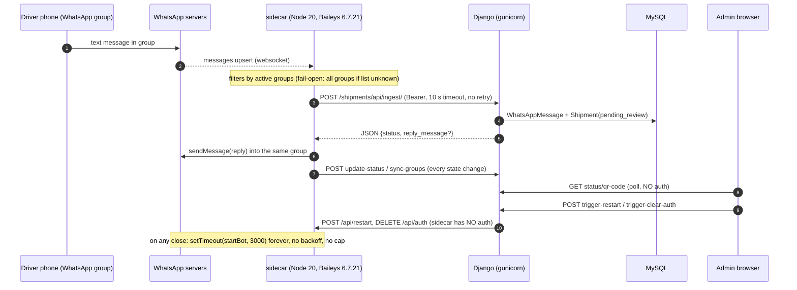

# WhatsApp investigation

**Bottom line:** the production sidecar is **not logged in and cannot log in**: WhatsApp answers every connection with HTTP 405 because `sidecar/index.js:122` pins an old WhatsApp-Web version. That is confirmed by an experiment (below), not guessed. Behind that primary outage sit about a dozen reliability and security defects that would make the feature fragile and unsafe even after it is reconnected.

Evidence files are in `qa/evidence/`. Test harnesses are `qa/tests/sidecar_harness.cjs` (real `index.js`, WhatsApp and Django stubbed) and `qa/tools/wa_version_probe.cjs`. No WhatsApp message was sent by any test; I was not given a test number, so nothing was sent to anyone. I did make three short, registration-only connections from my own machine (no QR scanned, no session created) to answer one question: *does WhatsApp accept this client?*

## 1. Flow

Library: **Baileys (`@whiskeysockets/baileys`) 6.7.21**, an unofficial reverse-engineered WhatsApp-Web client (not whatsapp-web.js, no Chromium needed, not the official Cloud API). The sidecar image still installs Chromium, which nothing uses.

## 2. Primary outage: why it is down (confirmed)

Production log (`docker logs fila-whatsapp-sidecar`, 2026-11-14 10:12–10:14 UTC): an endless loop of `not logged in, attempting registration...` → `Connection Failure` → `reason: 405` → reconnect after 3 s, with `Restarts=3, OOMKilled=false`.

| Experiment (same Baileys 6.7.21, my home connection, fresh empty session) | Result |
|---|---|
| WhatsApp-Web version pinned in `index.js:122` = `2.3000.1034074495` | **405 Connection Failure** (identical to production) |
| Version from Baileys' `fetchLatestBaileysVersion()` = `2.3000.1043857760` | **QR code issued: accepted** |
| Baileys 6.7.24 with **no** version argument (library default `2.3000.1043857760`) | **QR code issued: accepted** |

So: the pinned version is rejected by WhatsApp; the current one is accepted; the datacenter IP is not required to explain it. (I cannot prove the Oracle IP is not *also* penalised. After the fix, a QR appearing on the server settles that.)

Two facts explain "it worked for months and now it does not":
1. A pinned client version ages out. An already-paired session can keep working on an old version for a while, but **registration of a new device is checked strictly**. *(Suspected, consistent with the evidence.)*
2. The log says `not logged in`, so the session files are gone or were never valid. Something reset the session (phone logout, the "Clear auth" button, a deleted volume, or *any* internet user calling the unauthenticated `DELETE /api/auth`, see §3). Once reset, the stale version blocked re-pairing. *(Which of these happened is unknown; the diagnostics script reads `creds.json` mtime and the `whatsapp_log` timeline to tell.)*

The repo's `patches/baileys+6.7.0.patch` was meant to help with exactly this class of problem but never applies: it targets package `baileys` (not `@whiskeysockets/baileys`) and version 6.7.0 (`patch-package` prints "Patch file found for package baileys which is not present", reproduced), and production logs show `"platform":"WEB"`, so it is not active.

## 3. Failure modes found

Legend: **C** confirmed by a reproducing test/harness, **S** suspected (code reading, needs prod data), task IDs refer to `TASKS.md`.

| # | Failure mode | Evidence | Impact | Task |
|---|---|---|---|---|
| 1 | Pinned WhatsApp-Web version rejected (405) | probe above (C) | feature fully down | QA-001 |
| 2 | Sidecar REST API has **no authentication**; reachable on host port 3001 and publicly via nginx `/sidecar/`. `GET /api/qr-code` leaks the pairing code; `DELETE /api/auth` wipes the session; `POST /api/restart` | harness `noauth_api`: QR leaked, `session_files_left=[]` after an unauthenticated DELETE (C); `nginx.conf` `/sidecar/` block, compose `3001:3001` (C) | anyone can take the bot offline or hijack pairing | QA-002 |
| 3 | Django mirrors QR/status/logs/groups on public `@csrf_exempt` GET routes | 4 failing tests (C) | same, plus group names/log disclosure | QA-003 |
| 4 | Shared secret is a constant committed to the repo; Django never reads the env var that compose sets | test `WA-SECRET` (C) | anyone with the repo can forge shipments and call control endpoints | QA-004 |
| 5 | Unhandled promise rejection kills the process: if Django is unreachable and the socket is closed, `sendMessage` inside the `catch` throws, Node 20 exits 1 | harness `crash`: exit code 1 (C). Docker `restart: unless-stopped` then restarts, which fits `Restarts=3` (S for the real trigger) | the "restarted once" you saw; messages in flight are lost | QA-015 |
| 6 | One `/api/restart` creates **two** live sockets with the same credentials (manual `startBot` + the close handler's `startBot`) → WhatsApp "connection replaced" ping-pong | harness `restart_dup`: 2 created, 2 open (C) | disconnect loops, ban-risk signal | QA-015 |
| 7 | Every successful (re)connect registers another never-cleared 30 s `setInterval` | harness: 4 opens → 4 intervals (C) | growing request storm against Django, slow memory growth | QA-015 |
| 8 | Reconnect on a flat 3 s timer forever, for every close reason (405, 401-logged-out is the only exception), no backoff, no max | harness: 5 attempts in 13 s (C) = ~1,200/h; each one writes a `WhatsAppLog` row in Django | log flood, WhatsApp throttling, hides real errors | QA-015, QA-045 |
| 9 | Bot answers **every** group message, including chit-chat. Django returns `status:"flagged"` for "ok thanks boss" and the sidecar posts "⚠️ System flagged the shipment…" into the group; the message is also stored as a flagged error row | harness `noise` + test `WA-NOISE` (C) | spam in the dispatch group (account-ban risk), noisy admin view | QA-016 |
| 10 | Fail-open group filter: if Django is unreachable or no group is marked active, the sidecar listens to **all** groups and DMs and replies in them | code `index.js:213-220, 333-337` (S) | bot replies in unrelated chats | QA-020 |
| 11 | "Sync groups" resets every group to active | test `WA-SYNC-RESET` (C) | admin's selection silently lost | QA-019 |
| 12 | QR and last error are never cleared in Django after connecting | tests (C) | stale QR visible (and public, see #3) | QA-019 |
| 13 | Driver is matched with `phone_number__icontains="<digits>@s.whatsapp.net"` and never matches the E.164 stored number | test `WA-DRIVER` (C). Newer WhatsApp also sends `@lid` ids, which Baileys 6.7.x cannot map to numbers (S) | every ingested shipment has no driver | QA-017 |
| 14 | Customer default rate ignored → shipments ingested with amount 0 | test `WA-RATE` (C) | $0 line items on invoices | QA-017 |
| 15 | No idempotency: sidecar sends no message id, Django has no unique key; re-delivery after reconnect creates a second shipment (only flagged) | harness `dedupe`: 2 POSTs; test `WA-DEDUPE` (C) | duplicate shipments | QA-018 |
| 16 | Django 500s on malformed payloads (JSON array, non-string `text`) | 2 tests (C) | noisy errors, sidecar replies "format help" | QA-018 |
| 17 | Message date uses UTC; fleet is in Illinois | test `WA-TZ` (C) | evening loads dated next day | QA-018 |
| 18 | One-way, no retry: sidecar → Django has a 10 s timeout and a single attempt; failure replies in the group with format help and the message is **lost** (only the in-memory 500-line log remembers it) | `index.js:227-284` (C by reading) | silent data loss during any Django restart/deploy | QA-018 |
| 19 | Baileys 6.7.21 is in a **critical** advisory range (message-upsert/history-sync spoofing); fixed in ≥6.7.22 | `npm audit`, `qa/evidence/npm_audit_summary.txt` (C) | forged "shipment" messages | QA-021 |
| 20 | Build is not reproducible: lockfile says `baileys: latest`, committed `node_modules` (73 packages, no `express`) is copied over `npm install` output because the sidecar has no `.dockerignore`; patch never applies | `git ls-files`, clean-install experiment (C) | "works on my machine" differences between builds | QA-022 |
| 21 | Dev compose: Django points at `http://sidecar:3001` but the service is `whatsapp-sidecar`; dev mounts the volume at `auth_info_baileys` while code uses `auth_data` | `docker-compose.yml` (C by reading, stack not run) | dev: session lost on every restart, buttons fail | QA-041 |
| 22 | No healthcheck, runs as root, 2 CPU / 1 GB limit only in dev compose, no resource limits in prod | compose files (C) | cannot detect "alive but disconnected" | QA-025 |
| 23 | Django → sidecar calls happen inside the request with 10 s timeouts on 4 sync gunicorn workers (30 s default timeout) | `api.py` trigger_* (C by reading) | acceptable for rare admin clicks; not for anything per-message | note |

Things I checked that are **fine**: `WHATSAPP_SIDECAR_URL` in prod compose uses the service name (`http://sidecar:3001`), the session folder in `docker-compose.prod.yml` is mounted on a named volume at the path the code uses (`auth_data` ↔ `/app/sidecar/auth_data`), there is a restart policy, no Chromium/Puppeteer is actually used by Baileys (so `/dev/shm`, sandbox flags and zombie-Chromium problems do **not** apply), and memory was not the cause (`OOMKilled=false`). Phone-format, long-text, media and Arabic handling: Arabic and long text did not crash (tests pass); media messages and captions are silently ignored by the sidecar (only `conversation` and `extendedTextMessage` are read).

## 4. Local vs production

| | Local (mine / dev compose) | Production |
|---|---|---|
| Baileys / WA version | same 6.7.21, same pinned version | same: 405 for a *new* registration |
| Session persistence | dev compose mounts the wrong path → lost on restart | correct volume → persistent *(not verified live)* |
| Sidecar URL from Django | dev compose: wrong service name | `http://sidecar:3001` correct |
| Celery / Redis | present in dev compose | **absent** |
| Exposure | ports published on dev machine only | 3001 and 8888 on 0.0.0.0 + nginx `/sidecar/` |
| Secrets | defaults | defaults *(secret env var ignored by Django either way)* |
| Network | residential IP | Oracle datacenter IP; WhatsApp is stricter with datacenter ranges *(general knowledge, unproven here)* |

## 5. Is the current approach reliable enough?

**No.** The unofficial-protocol client itself is acceptable for a one-person dispatch tool, *if* it is kept current and wrapped properly. Today it has no authentication, no health signal, no retry or durable queue, a reconnect loop that can hammer WhatsApp, a crash path, and a build that nobody can reproduce. WhatsApp also actively bans accounts that automate in ways it dislikes; a bot that replies to every chat line in a group (#9) is exactly that pattern. Use a **dedicated SIM/number**, never the owner's personal one.

## 6. Options and trade-offs

| Option | Effort | Reliability | Cost / risk |
|---|---|---|---|
| **A. Harden the current sidecar** (recommended now): Baileys ≥6.7.24 + library-default version (or `fetchLatestBaileysVersion` with fallback), auth on every route, close port 3001 and `/sidecar/`, fix crash/dup/leak/backoff, reply only to valid shipment messages, healthcheck, idempotency key, durable retry | S–M (1–3 days) | good, but still an unofficial protocol: breaks whenever WhatsApp changes it; needs monitoring and a ~quarterly dependency bump | free; ban risk stays low-but-nonzero |
| B. Move to Baileys 7.x (`7.0.0-rc14` is the `latest` tag, still release-candidate) | M | unknown until stable | API changes; wait for stable |
| C. Official WhatsApp **Cloud API** (Meta) | L (1–2 weeks: business verification, templates, webhook endpoint in Django, drivers must message a business number, groups are **not supported**) | highest, no session/QR, supported | per-conversation fees, workflow change for drivers (no group) |
| D. Replace WhatsApp ingestion with a driver web form/PWA or Telegram bot | M | high, owned by you | drivers must change habit |

Recommendation: **A now** (it restores service and closes the critical holes), run it for a month with the new health checks, then decide about C if the business needs guaranteed delivery or multiple dispatchers.

## 7. Recommended fix plan (after your approval)

1. **Restore service (S):** upgrade Baileys to 6.7.24, drop the pinned `version`, rebuild image without committed `node_modules`, re-pair with a QR scan on a dedicated number. *(QA-001, QA-021, QA-022)*
2. **Close the doors (S, same release):** remove `ports: 3001`, remove nginx `/sidecar/`, require the secret on every sidecar route, require login/secret on the Django GET routes, read the secret from env and rotate it. *(QA-002/003/004)*
3. **Stop the bleeding in the sidecar (M):** single-flight reconnect with exponential backoff + jitter and special handling per close code (401 stop, 405/428/515 reconnect, 440 stop and alert), clear intervals, catch every `sendMessage`, process-level `unhandledRejection` logging, `/health` that reports WhatsApp connection state, Docker `HEALTHCHECK`. *(QA-015)*
4. **Make ingestion lossless (M):** send WhatsApp message id; unique constraint; Django returns 2xx quickly; sidecar retries with a small on-disk queue; ignore non-shipment chatter silently; fix driver/rate/timezone. *(QA-016/017/018/020)*
5. **Operate it (S):** run `prod_diagnostics.sh` weekly or wire an uptime alert on `/health`; log rotation (`max-size`), prune `WhatsAppLog`. *(QA-045)*

## 8. What to look for when you run `qa/prod_diagnostics.sh`

Read the **SUMMARY OF FLAGS** at the bottom first. Then:

| Section | Look for | Meaning |
|---|---|---|
| 2 | `restarts=` > 0, `OOMKilled=true`, `exitCode=1` on the sidecar | exit code 1 + no OOM supports the unhandled-rejection crash (#5) |
| 3 | `creds.json: MISSING` or `registered:false`; its mtime; baileys version `6.7.21`; patch marker count `0`; `express installed: yes/NO` | confirms "not logged in", when the session ended, and which Baileys is really in the image |
| 3 logs | counts of `405`, `401 loggedOut`, `440 connectionReplaced`, `Unhandled…` | 405 = this outage; 440 = two sockets fighting; "Unhandled" = crash path |
| 4 | `GET http://sidecar:3001/health` from Django returns 200; DNS for `sidecar` resolves; TCP to `web.whatsapp.com:443` OK; "sidecar's DJANGO_SECRET equals the repo default? YES" | internal connectivity is fine / secret is the public constant |
| 5 | `SECURE_*`, `DEBUG`, `.env key NAMES`; `WORKER TIMEOUT` count; tracebacks | production hardening and gunicorn trouble |
| 6 | `whatsapp config row` (`last_connection_time`, `last_error_time`), `whatsapp_log rows per day`, `last message received at`, flagged vs processed counts | **when** WhatsApp last worked, size of the reconnect-loop log flood |
| 6 | backups lines | whether any MySQL dump exists |
| 7 | published ports, `/sidecar/api/status -> HTTP 200`, `qr-code (no login) -> HTTP 200` | confirms the public exposure (the script only does GETs against localhost) |
| 8 | served cert vs on-disk cert, "no certbot deploy/post hook" | the nginx-not-reloaded time bomb |

Send me the whole output file; it contains no secret values (env var names only, digits masked, session files by name only).

---

## 9. Production evidence (qa/prod_diagnostics.sh run on 2026-11-14, read-only) and how the fixes answer it

| Observation on the server | What it means | Fixed by |
|---|---|---|
| `405 Connection Failure` x 35,768 in the retained log; the pinned version string is still in `index.js:122`; `status = disconnected / not_authenticated`, no `creds.json`, `groups = 0` | My experiments were right: WhatsApp rejects the pinned WhatsApp-Web version, so the sidecar cannot even show a QR. The empty group table follows from the session having been cleared (the old *Clear auth* also deleted every group). | QA-001 (current version fetched at every connect, Baileys 6.7.24), QA-019 (clear auth keeps groups) |
| Last message received `2026-06-09 12:29`, the sidecar container started `2026-06-09 12:30`, `last connection` in the config row the same minute | Consistent with WhatsApp having worked until that restart and never again afterwards (inference, the log does not say when the first 405 appeared): the bot may have been **offline for about 5 months**, not just since this week. The restart (`RestartCount=3`, previous exit code `0`) was a clean stop, not a crash. | QA-001 |
| `auth_data` directory modified `2026-11-12 20:42`, empty | The session folder was cleared that evening. I cannot tell whether it was a button press, a logout from the phone or someone calling the open `DELETE /api/auth`. Both of the last two possibilities were open to the internet. | QA-002, QA-003 |
| `unhandled rejection / fatal: 0`, previous exit code `0` | My Phase 1 suspicion that the sidecar crash path caused the 3 restarts is **not supported** by production (TASKS.md QA-015 says so). The crash path is still real in the harness and is fixed. | QA-015 |
| `440 connectionReplaced` x 316, `401 loggedOut` x 15, `515` x 4 | Sessions were replaced/unlinked repeatedly, consistent with the duplicate-socket bug (one restart left two sockets using the same credentials) and with re-pairing attempts. | QA-015 (one socket, policy per status code) |
| `sidecar still uses the repo-default shared secret`, port 3001 published, `/sidecar/api/status` and the QR endpoint answer 200 from outside | Confirmed live: anyone could read the pairing QR and wipe or hijack the session. | QA-002, QA-003, QA-004 |
| `whatsapp_log` 43,222 rows in 5 days, 24,150 on one day | The reconnect loop wrote a database row per attempt. | QA-045 |
| sidecar log 3,923,374 lines in one unbounded file | | QA-025 (log rotation) |
| 26 stored WhatsApp messages in total, the last one on 2026-06-09; 17 shipments, the latest created on 2026-11-13 (necessarily by hand) | Volume is tiny: re-entering by hand is feasible while the bot is down, and a dedicated number can be tested safely. | |

**Re-pairing checklist:** `qa/DEPLOYMENT.md` section 7.
